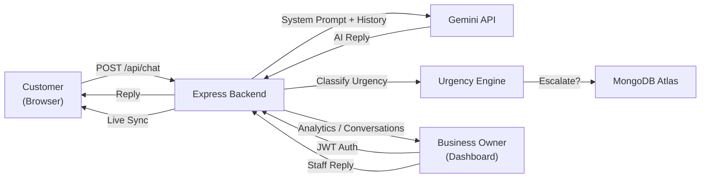

# How to Describe "Allié" in an Interview

---

## The One-Liner (Elevator Pitch)

> **"Allié is an AI-powered customer support SaaS platform I built from scratch. Businesses sign up, configure their store profile and FAQs, and get an embeddable AI chatbot that handles customer queries 24/7 — with automatic urgency detection, smart escalation to human staff, and a real-time analytics dashboard."**

---

## Structured Project Description (2–3 Minutes)

Use this flow in an interview — it covers **what, why, how, and what you learned**:

### 1. What is it?
*"Allié is a full-stack SaaS platform that gives small-to-medium businesses their own branded AI customer support chatbot. A business owner signs up, sets up their store profile — name, location, FAQs, contact info — and gets a public chat page their customers can use. The AI assistant is contextually aware of their specific business."*

### 2. What problem does it solve?
*"Small businesses can't afford dedicated 24/7 support teams. Allié bridges that gap by automating routine questions with AI while intelligently escalating urgent or complex issues — like payment disputes, security concerns, or delivery failures — to human staff. The business owner gets a dashboard showing exactly which conversations need their attention."*

### 3. Tech Stack
| Layer | Technology |
|-------|-----------|
| **Frontend** | React 19, Vite 8, Tailwind CSS 4, Recharts, Framer Motion, React Router v7 |
| **Backend** | Node.js, Express 5, Mongoose/MongoDB Atlas |
| **AI Engine** | Google Gemini API (gemini-flash-lite) with structured system prompts and conversation history |
| **Authentication** | JWT (7-day expiry), bcrypt password hashing, Zod schema validation |
| **Email Verification** | Multi-provider email delivery (Brevo API → Resend API → SMTP fallback), 6-digit OTP codes |
| **Deployment** | Vercel (frontend), Render (backend), MongoDB Atlas (database) |

### 4. Key Features You Should Highlight

#### AI Chat Engine with Context Awareness
*"The chatbot isn't just a generic AI — it receives a dynamically constructed system prompt that includes the business's name, description, FAQ knowledge base, and even urgency classification training data. The AI responds as '[BusinessName]'s Allié', maintaining brand identity across every conversation."*

#### Real-Time Urgency Detection & Escalation Pipeline
*"I built a keyword-based urgency classifier that categorizes every message into critical, high, medium, or low urgency with matched intents like 'billing', 'security', 'order', or 'technical'. Critical issues like account compromises or service outages get auto-escalated; the system flags these conversations and routes them to staff in real time."*

> [!TIP]
> This is a great feature to deep-dive on — interviewers love hearing about **classification logic** and **decision trees** you designed.

#### Analytics Dashboard
*"The admin dashboard aggregates real-time metrics: total chats, resolution rate, AI confidence score, escalation rate, customer satisfaction (CSAT) rating, and FAQ gap analysis. It includes a bar chart showing chat volume trends (7-day / 30-day views) and an 'Unanswered Questions' section that surfaces topics the AI couldn't resolve — with one-click 'Add to FAQ' buttons so the business owner can continuously improve the bot."*

#### Conversations Desk with AI/Human Channel Separation
*"The conversations page separates chats handled entirely by AI from those requiring human intervention. Staff can filter by 'Needs Staff Reply', view AI-generated summaries of each conversation, send staff replies that appear in the customer's live chat, pin important conversations, and mark tickets as resolved."*

#### Full Auth Flow with Email Verification
*"I implemented a complete authentication system — registration with email verification via 6-digit OTP codes, login, password reset, all with Zod schema validation. The email delivery system has a 3-tier fallback chain: Brevo HTTP API → Resend HTTP API → SMTP, making it work reliably even on free hosting tiers with port restrictions."*

#### Embeddable Customer Chat with Store Hub
*"Each business gets a public URL (`/support/:businessId`) where customers chat with the AI. The chat page shows the business's branding, a 'Store Hub' drawer with location, contact info, social links, and store ratings. It includes features like session persistence, single-tab concurrency protection via BroadcastChannel API, real-time message syncing for staff replies, and thumbs up/down feedback."*

---

## Memory Management — Deep Dive

> [!IMPORTANT]
> This is an **excellent interview talking point**. It shows systems thinking and real-world problem solving.

### How We Manage Memory (The 3-Store Architecture)

Allié uses a **3-tier in-memory architecture** on the backend to maintain fast, stateful conversations without relying solely on database round-trips:

```
┌─────────────────────────────────────────────────────────────┐
│ SERVER MEMORY (Node.js) │
│ │
│ ┌─────────────────────────┐ │
│ │ inMemoryConversationStore (Map) │
│ │ Key: sessionId │
│ │ Value: { businessId, sessionId, customerName, │
│ │ messages[], unresolvedTopics[], status } │
│ └──────────────┬──────────┘ │
│ │ │
│ ┌──────────────▼──────────┐ │
│ │ sessionStateStore (Map) │
│ │ Key: sessionId │
│ │ Value: { sessionId, customerName, messages[] } │
│ │ (Lightweight snapshot for quick state checks) │
│ └──────────────┬──────────┘ │
│ │ │
│ ┌──────────────▼──────────┐ │
│ │ userNameMemoryStore (Map) │
│ │ Key: sessionId │
│ │ Value: "John" (extracted customer name) │
│ │ (Persistent name recall across entire session) │
│ └─────────────────────────┘ │
│ │
└──────────────────────┬──────────────────────────────────────┘
 │ Async Persist
 ▼
 ┌─────────────────┐
 │ MongoDB Atlas │
 │ (Durable Store) │
 └─────────────────┘
```

### The 3 In-Memory Stores Explained

| Store | Type | Purpose | Key → Value |
|-------|------|---------|-------------|
| `inMemoryConversationStore` | `Map()` | Full conversation state — messages, urgency flags, escalation status | `sessionId` → complete conversation object |
| `sessionStateStore` | `Map()` | Lightweight snapshot for quick state resolution without touching the full store | `sessionId` → `{ sessionId, customerName, messages }` |
| `userNameMemoryStore` | `Map()` | Remembers the customer's name across the entire session so the AI can address them personally | `sessionId` → `"customer name"` |

### How It Works — The Flow

**Step 1: Request arrives** → Check `inMemoryConversationStore` for existing session

**Step 2: Cross-reference with DB** → If MongoDB has a conversation too, pick whichever has **more messages** (handles server restarts gracefully):
```js
conversation = inMemory.messages.length > dbConversation.messages.length
 ? inMemory // Memory is ahead (user sent messages before DB synced)
 : dbConversation; // DB is ahead (server restarted, memory was lost)
```

**Step 3: Name extraction & memory** → Regex scans user messages for patterns like *"my name is John"*, *"I'm Sarah"*, *"call me Alex"* and stores it in `userNameMemoryStore`:
```js
const match = message.match(
 /(?:my name is|i am|i'm|call me|you can call me)\s+([a-z][a-z' -]{1,30})/i
);
```

**Step 4: Name resolution priority chain** → When needing the customer's name, it checks in order:
1. `sessionStateStore` (fastest)
2. `conversation.customerName` field
3. `userNameMemoryStore` (direct lookup)
4. Re-scan all messages with `extractKnownUserName()` (last resort)

**Step 5: Persist back** → After processing, state is saved to all 3 stores + async write to MongoDB:
```js
persistSessionState(sessionId, conversation); // Updates sessionStateStore + userNameMemoryStore
inMemoryConversationStore.set(sessionId, conversation); // Full state
await dbConv.save(); // Durable persistence
```

### Why This Design? (What to Say in Interview)

> *"I designed a dual-layer storage system — in-memory Maps for sub-millisecond reads during active conversations, with async persistence to MongoDB for durability. This gives us the speed of in-memory stores with the reliability of a database. If the server restarts, we gracefully recover from MongoDB. If the DB has momentary latency, the chat still responds instantly from memory."*

> *"The 3 separate Maps serve different access patterns — the conversation store holds full chat state, the session store is a lightweight snapshot for quick checks, and the name store is a dedicated identity cache so the AI can remember and use the customer's name naturally throughout the conversation."*

### Key Trade-offs to Mention

| Trade-off | Decision | Reasoning |
|-----------|----------|-----------|
| Memory vs. Speed | Keep conversations in RAM | Chat needs sub-second responses; DB round-trips add 50-200ms |
| Consistency vs. Availability | Memory-first, DB-async | Better UX; minor risk of losing last message on crash |
| Single-server vs. Distributed | Single-server Maps | Appropriate for current scale; would move to Redis for horizontal scaling |
| Redundant stores vs. Single store | 3 separate Maps | Different access patterns; name lookups shouldn't scan entire conversation objects |

### What You'd Improve (Shows Growth Mindset)

*"For horizontal scaling, I'd replace the in-memory Maps with Redis — it gives the same O(1) key-value performance but works across multiple server instances. I'd also add TTL-based expiry so inactive sessions are garbage-collected automatically, and implement a write-ahead log pattern for stronger consistency guarantees."*

---

## Architecture




---

## What to Say When They Ask "What challenges did you face?"

Pick 2-3 of these:

1. **AI Fallback Resilience**: *"The Gemini API can timeout or be unavailable, so I built a multi-model fallback chain (tries gemini-flash-lite first, then gemini-3.5-flash-lite) with a local smart-fallback function that uses FAQ matching and intent detection to still give useful answers even without the API."*

2. **Multi-Provider Email Delivery**: *"On Render's free tier, outbound SMTP ports are blocked. I had to architect a 3-tier email fallback — Brevo HTTP API, then Resend HTTP API, then SMTP — so verification and password reset emails reliably deliver regardless of hosting environment."*

3. **Memory & Session State Management**: *"I implemented a 3-store in-memory architecture — conversation store, session state store, and user name memory — with async persistence to MongoDB. This gives sub-millisecond chat responses while maintaining durability. The system gracefully recovers from server restarts by cross-referencing memory with the database and keeping whichever has more messages."*

4. **Urgency Classification**: *"I designed a rule-based urgency classifier with keyword scoring and intent mapping. I also created training data in JSON format that's fed into the AI's system prompt so the LLM learns the escalation patterns and produces consistent urgency-aware responses."*

5. **Real-Time Cross-Tab Chat Sync**: *"I used the BroadcastChannel API and localStorage events to implement single-instance protection — preventing duplicate chat sessions across browser tabs, which would otherwise cause message duplication and state corruption."*

---

## Common Interview Q&A

**Q: Why did you choose this tech stack?**
> *"React with Vite for fast dev experience, Express for flexible REST APIs, MongoDB for its schema flexibility with chat data that can vary in structure, and Gemini API because it offers low-latency models (flash-lite) suitable for real-time chat responses."*

**Q: How does the AI know about each business?**
> *"Each chat request dynamically constructs a system prompt that injects the business's name, description, FAQ knowledge base, store contact info, and urgency training examples. The AI gets full conversation history for context continuity."*

**Q: How do you handle security?**
> *"Passwords are hashed with bcrypt (salt rounds = 10). JWT tokens expire after 7 days. Email verification uses time-limited 6-digit OTP codes. Input is validated with Zod schemas at the middleware level. The chat endpoint validates required fields before processing."*

**Q: How do you manage memory and state?**
> *"I use a 3-tier in-memory architecture — a conversation store, session state store, and name memory store — all backed by async MongoDB persistence. Memory serves as the fast read/write layer for active conversations while MongoDB provides durability. On each request, I cross-reference both layers and use the one with more data to handle server restarts gracefully."*

**Q: Is this deployed?**
> *"Yes — the frontend is on Vercel at `wholeallie.vercel.app`, the backend on Render, and the database on MongoDB Atlas. The entire system is production-ready with error handling, graceful degradation, and fallback mechanisms."*

**Q: What would you improve next?**
> *"I'd replace the in-memory Maps with Redis for horizontal scaling, add WebSocket support for true real-time messaging instead of polling, implement RAG (Retrieval Augmented Generation) for richer knowledge base search, add multi-language support, and build a widget SDK for embedding the chat into any website."*

---

## Key Buzzwords to Naturally Drop

- Full-stack SaaS application
- RESTful API design
- AI/LLM integration (Gemini API)
- Real-time urgency classification & escalation
- In-memory caching with async persistence
- Multi-tenant architecture (each business is isolated)
- JWT-based authentication with email OTP verification
- Analytics pipeline with CSAT metrics
- Graceful degradation & fallback patterns
- MongoDB document modeling
- Dual-layer storage (memory + database)
- Neo-brutalist UI design system

> [!IMPORTANT]
> **Don't just list technologies — always connect them to a *decision* or *problem* you solved.** That's what separates a junior-level answer from a strong one.

---

> **A downloadable copy of this guide has been saved to your project at `c:\the\Bottted\INTERVIEW-GUIDE.md`**
