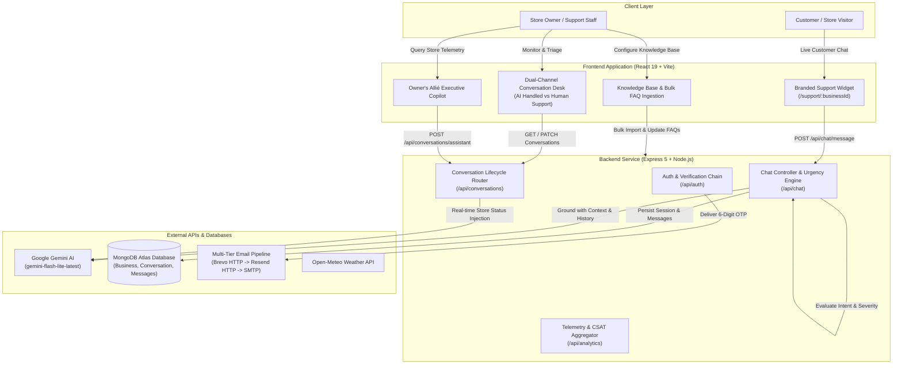

# Allié — AI-Powered Customer Support SaaS Platform

[](https://wholeallie.vercel.app)
[](https://react.dev/)
[](https://expressjs.com/)
[](https://www.mongodb.com/atlas)
[](https://aistudio.google.com/)
[](https://tailwindcss.com/)
[](https://opensource.org/licenses/ISC)

**Allié** is an end-to-end, multi-tenant AI customer support and operational management SaaS platform. Built for modern businesses, Allié equips store owners with a branded, context-aware AI support agent that handles inquiries 24/7, detects urgency in real time, routes escalated cases to human staff, and provides business owners with executive analytics and an administrative AI copilot.

---

## Architecture & Data Flow



---

## Core Engineering Highlights

### 1. Autonomous Context-Aware Agent
- **Dynamic Knowledge Grounding**: Constructs real-time system prompts tailored to each merchant, injecting company profile, operating hours, delivery policies, return guidelines, and FAQ knowledge bases into Google Gemini (`gemini-flash-lite-latest`).
- **Conversational Memory**: Tracks customer identity, remembered names, and multi-turn context across sessions.
- **Deterministic Guardrails**: Strict fallback matcher ensures queries regarding store hours, locations, or order tracking receive accurate answers even during intermittent API timeouts.

### 2. Intelligent Urgency & Escalation Engine
- **4-Tier Severity Classification**: Evaluates incoming customer messages across `critical`, `high`, `medium`, and `low` thresholds with intent mapping (`security`, `billing`, `order`, `account`, `technical`, `return`).
- **Smart Escalation Triggers**: Critical issues (account compromises, outages, duplicate payments) and natural language human requests (e.g., *"talk to a representative"*, *"connect to an agent"*) automatically escalate tickets to human support.
- **Safe Signoff Filtering**: Eliminates false escalations by distinguishing polite AI closings from genuine unresolved queries.

### 3. Dual-Stream Conversation Desk
- **Channel Partitioning**: Real-time separation between automated **AI Handled** conversations and **Human Support** tickets requiring staff action.
- **Unified Status Lifecycle**: Distinct badge states (`Open`, `Needs Staff`, `Awaiting Staff`, `Staff Handled`, `Resolved`) reflecting current ticket ownership.
- **AI Executive Summaries**: Single-click Gemini AI summaries breaking down customer inquiries, AI actions taken, and current status for rapid handoffs.
- **Two-Way Live Stream**: Support staff can review transcripts, pin high-priority tickets, send staff replies that appear directly in the customer's chat, and toggle resolution states.

### 4. Owner's Allié Executive Copilot
- **Live Database Telemetry**: The administrative copilot queries real-time MongoDB data to provide store owners with instantaneous insights regarding active chats, sentiment trends, and common customer concerns.
- **Conversational Continuity**: Full multi-turn memory maintains conversation context throughout admin sessions.
- **Expandable Workspace**: Expandable neo-brutalist panel with one-click quick actions and cancelable generation states.

### 5. Multi-Format Bulk FAQ Ingestion
- **Heuristic Parsing Engine**: Allows merchants to paste entire FAQ documentation blocks in multiple notations:
  - `Q: ... A: ...` notation
  - Pipe-separated (`Question | Answer`)
  - Numbered queries (`1. Question? \n Answer`)
  - Natural paragraph pairs
- **Immediate Card Generation**: Automatically converts unstructured text into validated question-and-answer pairs with one-click deletion and editing before saving to MongoDB.

### 6. Configurable Vector QR Code Engine
- **8 Vector Patterns**: Supports `Classic` (square), `Rounded`, `Dots`, `Premium` (extra-rounded), `Classy`, `Classy Round`, `Star`, and `Diamond` dot/corner styles powered by `qr-code-styling`.
- **8 Brand Palettes**: One-click color swatches (`Ink`, `Purple`, `Midnight`, `Red`, `Green`, `Blue`, `Amber`, `Violet`) with a centered brand monogram badge.
- **Print Optimization**: Native `@media print` layout produces clean, ink-friendly printed signage ready for store counters.

### 7. Resilient 3-Tier Email Delivery Architecture
- **Failover Chain**: Automatically attempts delivery via **Brevo HTTP API** first, falls back to **Resend HTTP API**, and concludes with **SMTP** to circumvent outbound port restrictions (ports 25, 465, 587) on free cloud tiers like Render.
- **Gmail Quick Action Formatting**: Minimalist, high-deliverability NxtWave OTP format designed to avoid spam filters and trigger Gmail's 1-click "Copy verification code" quick action button.

### 8. Live Store Atmosphere & Geo Telemetry
- **Dynamic Weather Card**: Pulls real-time temperature, weather condition codes, relative humidity, and wind speed via the Open-Meteo API.
- **Day/Night Responsive**: Vector day and night skies with live clock telemetry reflecting the merchant's local time zone.

### 9. Tactile Neo-Brutalist Design System
- High-contrast aesthetic with `3px solid #252b3a` borders, `box-shadow: 4px 4px 0 0 #252b3a` tactile elevations, cream canvas (`#fffdf5`), and fluid typography. Zero non-standard decorative emojis across the interface for a clean, professional finish.

---

## Tech Stack

| Layer | Technologies |
| :--- | :--- |
| **Frontend** | React 19, Vite 8, Tailwind CSS 4, React Router DOM 7, Recharts, Framer Motion, Lucide React, qr-code-styling |
| **Backend** | Node.js (v20+), Express.js 5, Mongoose 9, MongoDB Atlas, Zod 4, JSON Web Tokens (JWT), bcrypt |
| **AI Orchestration** | Google Gemini REST API (`gemini-flash-lite-latest`, `gemini-3.5-flash-lite`) |
| **Email Services** | Brevo HTTP API, Resend HTTP API, Nodemailer SMTP |
| **Telemetry APIs** | Open-Meteo Weather API |
| **Deployment** | Vercel (Frontend SPA), Render (Backend API), MongoDB Atlas (Cloud Database) |

---

## Project Structure

```text
├── backend/
│   ├── config/              # AI model keys, API endpoints & configuration
│   ├── data/                # Urgency & intent classification dataset
│   ├── middleware/          # JWT authentication, token decoding, and Zod validator
│   ├── models/              # Mongoose schemas (Business, Conversation)
│   ├── routes/
│   │   ├── analytics.js     # KPI metrics, CSAT calculation, and trend charts
│   │   ├── auth.js          # Registration, login, password reset & multi-tier OTP delivery
│   │   ├── chat.js          # Gemini bot runner, urgency classifier, memory persistence
│   │   ├── conversations.js # Desk view, AI executive summarizer, staff replies, pinning
│   │   ├── settings.js      # Business profile, FAQs, contact info, and customization
│   │   └── support.js       # Public customer support widget endpoint
│   ├── server.js            # Express application bootstrap & MongoDB connection
│   ├── package.json
│   └── .env.example
│
├── frontend/
│   ├── src/
│   │   ├── api/             # Axios instance with automatic JWT header interceptors
│   │   ├── components/      # Sidebar, WeatherTimeWidget, AdminCopilotWidget, WalkthroughModal
│   │   ├── pages/           # Dashboard, Conversations, Settings, Profile, CustomerChat, Login
│   │   ├── App.jsx          # Protected route hierarchy & router definitions
│   │   ├── main.jsx         # React 19 entry point
│   │   └── index.css        # Tailwind CSS 4 tokens & neo-brutalist utility definitions
│   ├── package.json
│   ├── vite.config.js
│   └── vercel.json          # SPA routing configuration for Vercel
│
├── INTERVIEW-GUIDE.md       # Architectural deep-dives and interview discussion points
├── UPGRADES-ROADMAP.md      # Feature roadmap and planned enhancements
└── README.md
```

---

## REST API Reference

### Authentication (`/api/auth`)
| Method | Endpoint | Description | Auth Required |
| :--- | :--- | :--- | :---: |
| `POST` | `/api/auth/register` | Register business, hash password, and dispatch 6-digit OTP | No |
| `POST` | `/api/auth/verify-code` | Verify 6-digit email OTP and activate account | No |
| `POST` | `/api/auth/login` | Authenticate credentials and return signed JWT token | No |
| `POST` | `/api/auth/resend-code` | Resend verification code (with cooldown throttling) | No |
| `POST` | `/api/auth/forgot-password` | Dispatch password reset verification code | No |
| `POST` | `/api/auth/reset-password` | Update account password using reset token | No |

### Customer Chat (`/api/chat`)
| Method | Endpoint | Description | Auth Required |
| :--- | :--- | :--- | :---: |
| `POST` | `/api/chat/message` | Ingest customer prompt, classify urgency, query Gemini, and return reply | No |
| `POST` | `/api/chat/feedback` | Record customer thumbs up/down rating for the session | No |

### Conversation Management (`/api/conversations`)
| Method | Endpoint | Description | Auth Required |
| :--- | :--- | :--- | :---: |
| `GET` | `/api/conversations` | Fetch all conversations with channel, priority, and unreplied flags | Yes |
| `GET` | `/api/conversations/:sessionId` | Retrieve full message transcript for a specific conversation | Yes |
| `POST` | `/api/conversations/:sessionId/reply` | Submit staff reply to customer live stream | Yes |
| `PATCH` | `/api/conversations/:sessionId/status` | Update conversation status (`open`, `resolved`) | Yes |
| `PATCH` | `/api/conversations/:sessionId/pin` | Toggle pinned state for priority desk ordering | Yes |
| `DELETE` | `/api/conversations/:sessionId` | Permanently remove conversation record | Yes |
| `POST` | `/api/conversations/:sessionId/summary` | Generate structured AI executive summary via Gemini | Yes |
| `POST` | `/api/conversations/assistant` | Query Owner's Allié copilot with live store telemetry | Yes |

### Analytics & Settings (`/api/analytics`, `/api/settings`)
| Method | Endpoint | Description | Auth Required |
| :--- | :--- | :--- | :---: |
| `GET` | `/api/analytics` | Retrieve KPI metrics (resolution rate, CSAT, trend series) | Yes |
| `GET` | `/api/analytics/alerts` | Fetch count of unresolved or urgent customer issues | Yes |
| `GET` | `/api/settings` | Retrieve store knowledge base, FAQs, contact info, and branding | Yes |
| `POST` | `/api/settings` | Save updated business description, bulk FAQs, and branding colors | Yes |
| `POST` | `/api/support/verify` | Validate merchant widget access via business ID | No |

---

## Local Development Setup

### Prerequisites
- **Node.js**: v18.0.0 or higher
- **MongoDB**: Local MongoDB instance or free [MongoDB Atlas Cluster](https://www.mongodb.com/atlas)
- **Google Gemini API Key**: Free API key from [Google AI Studio](https://aistudio.google.com/)

### 1. Clone & Configure Backend
```bash
git clone https://github.com/breadoldest-collab/wholeallie.git
cd wholeallie/backend

npm install
cp .env.example .env
```

Configure your `backend/.env` file:
```env
PORT=5000
MONGODB_URI=mongodb+srv://<username>:<password>@cluster0.mongodb.net/cxbot?retryWrites=true&w=majority
JWT_SECRET=your_super_secret_jwt_key_at_least_32_characters

# Google Gemini API
GEMINI_API_KEY=your_gemini_api_key

# Email Delivery (Optional for local testing; supports Brevo, Resend, or SMTP)
BREVO_API_KEY=your_brevo_api_key
RESEND_API_KEY=your_resend_api_key
SMTP_HOST=smtp.gmail.com
SMTP_PORT=587
SMTP_USER=your_email@gmail.com
SMTP_PASS=your_app_password
```

Start the backend server:
```bash
node server.js
# Backend listening on http://localhost:5000
```

### 2. Configure & Run Frontend
```bash
cd ../frontend

npm install
```

(Optional) Create `frontend/.env`:
```env
VITE_API_URL=http://localhost:5000
```

Start Vite dev server:
```bash
npm run dev
# Frontend ready on http://localhost:5173
```

---

## Production Deployment

### Frontend (Vercel)
1. Import repository into **Vercel** with **Root Directory** set to `frontend`.
2. Configure Environment Variable:
   - `VITE_API_URL`: Your deployed backend URL (e.g. `https://wholeallie-backend.onrender.com`).
3. Single Page Application (SPA) routing is handled automatically via [`frontend/vercel.json`](file:///c:/the/Bottted/frontend/vercel.json).

### Backend (Render / Railway / Cloud Run)
1. Deploy `backend` directory as a Node.js Web Service.
2. Build Command: `npm install`.
3. Start Command: `node server.js`.
4. Ensure `MONGODB_URI`, `JWT_SECRET`, and `GEMINI_API_KEY` are provided in environment variables.

---

## Key Engineering Decisions & Tradeoffs

1. **Why Gemini Flash-Lite?**
   Customer support interactions demand sub-second latency. Gemini Flash-Lite delivers deterministic, grounded responses within 400–800ms while keeping API overhead minimal compared to heavy frontier models.
2. **Rule-Based Urgency Classifier + Generative AI**:
   Rather than making an extra asynchronous LLM call to classify ticket urgency (adding 1–2s of latency), Allié uses a deterministic keyword and heuristic matrix in Express. This executes in under 2ms, guaranteeing instant escalation for critical keywords before the response is generated.
3. **HTTP Email API Fallback over Raw SMTP**:
   Many cloud platforms (like Render's free tier) restrict outbound SMTP traffic on ports 25, 465, and 587. Implementing a fallback chain from Brevo/Resend HTTP APIs (running over standard HTTPS port 443) to SMTP ensures 100% reliable OTP code delivery regardless of host network limitations.
4. **Resilient Offline Fallback**:
   If the database connection encounters latency or cold-start timeouts, the in-memory fallback store maintains active visitor conversations without dropping messages or breaking customer sessions.

---

## License

This project is open-source and available under the [ISC License](LICENSE).
